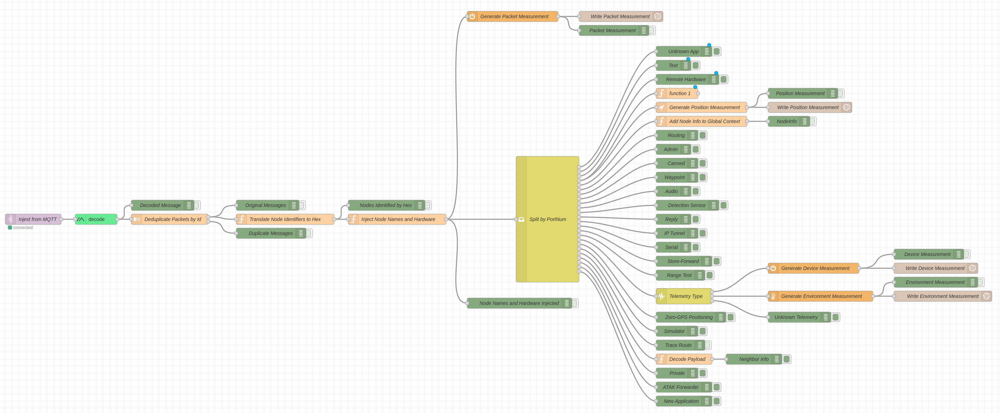

# meshtastic-node-red

A ready-made [Node-RED](https://nodered.org) flow that turns [Meshtastic](https://meshtastic.org) mesh
traffic into time-series data. It subscribes to your MQTT broker, decodes the protobuf packets,
deduplicates them, resolves node names, and writes measurements to InfluxDB so you can chart your mesh in
Grafana.

## Features

- Ingestion from MQTT
- Protobuf decoding
- Message deduplication by packet ID (5 minute window, so one packet heard by several gateways is stored once)
- Annotate integer-based node IDs as hex
- Annotate packets with known NodeInfo (long name, short name, hardware model)
- Split by every current port number
- Writing Mesh, Packet, Position, Device, Environment and Neighbor measurements to InfluxDB
- Debug nodes on all outputs

### Included subflows

- Ingest from MQTT
- Measurement: Mesh
- Measurement: Packet
- Measurement: Position
- Measurement: Device Telemetry
- Measurement: Environment Telemetry
- Measurement: Neighbors

## Requirements

- Node-RED
- An MQTT broker that your Meshtastic nodes publish to (Mosquitto works well)
- InfluxDB **1.x** (the flow uses the `influxdb` node with a database, not a v2 bucket)
- These Node-RED palette modules, installed before importing the flow:
  - [@meshtastic/node-red-contrib-meshtastic](https://flows.nodered.org/node/@meshtastic/node-red-contrib-meshtastic)
  - [node-red-contrib-influxdb](https://flows.nodered.org/node/node-red-contrib-influxdb)

## Quick start

1. Install the two palette modules above (Menu, Manage palette, Install).
2. Import [`meshtastic.json`](./meshtastic.json) (Menu, Import, paste or select the file).
3. Edit the two config nodes to match your environment. The defaults assume a Docker network:

   | Node | Default | Change to |
   |------|---------|-----------|
   | MQTT broker (`Mosquito`) | `mqtt-mosquitto:1883` | your broker host and port, plus credentials if you use them |
   | InfluxDB (`Local InfluxDB`) | `influxdb:8086`, database `msh` | your InfluxDB host, and a database you have created |

4. Make sure your Meshtastic nodes publish to the broker. The flow subscribes to `msh/+/c/#`.
5. Deploy. Packets should start appearing in the debug sidebar and in InfluxDB.

## Measurements written

| Measurement | Fields |
|-------------|--------|
| `Mesh` | Links between nodes (source, target) with SNR and RSSI |
| `Packet` | Receive time, SNR, RSSI, hop limit, priority, delayed |
| `Position` | Latitude, longitude, altitude, satellites in view, ground speed and track, PDOP |
| `Device` | Battery level, voltage, channel utilization, TX air utilization |
| `Environment` | Temperature, relative humidity, barometric pressure, gas resistance |
| `Neighbor` | Neighbor links from NeighborInfo packets, with SNR |

Every point is tagged with the sender and receiver (hex ID, short name, long name, hardware model), the
channel and the gateway.

## Compatibility

Last updated for Meshtastic firmware **2.2.15**. Newer firmware has not been tested against this flow, so
the protobuf definitions in the palette module may need updating. Issues and pull requests welcome.

## License

[The Unlicense](LICENSE). Public domain.
